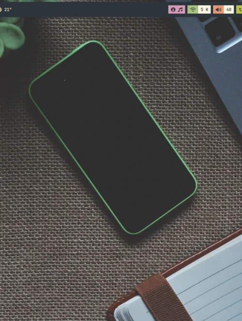
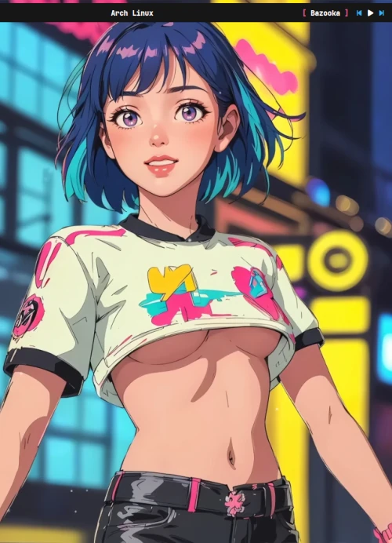
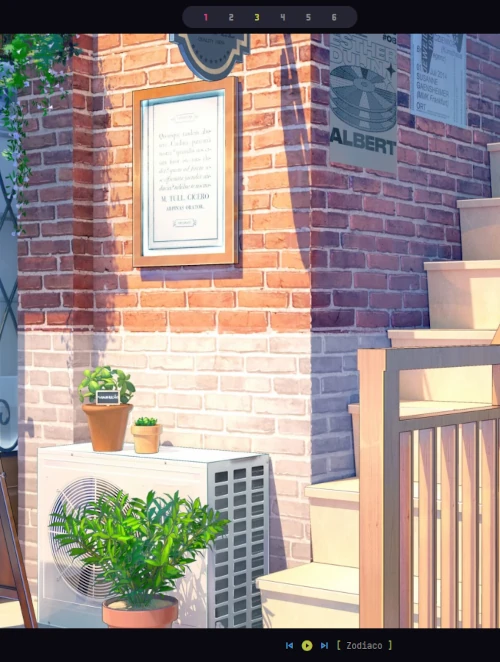
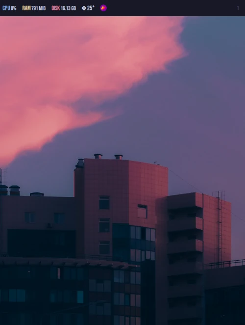
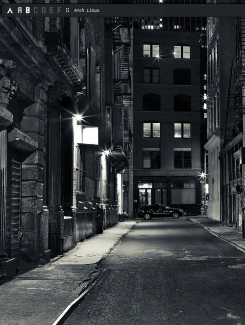

# A BSPWM environment, debloated

A personal fork of [gh0stzk/dotfiles](https://github.com/gh0stzk/dotfiles): the same desktop, minus the
anime art, the duplicate themes and the tooling this machine does not use. Eight themes, eight bars,
one terminal, one window manager, and keybinds that stay in your fingers.

<div align = center>

&ensp;[<kbd>&ensp;Install&ensp;</kbd>](#installation)&ensp;
&ensp;[<kbd>&ensp;Changes&ensp;</kbd>](#what-this-fork-changes)&ensp;
&ensp;[<kbd>&ensp;Themes&ensp;</kbd>](#the-themes)&ensp;
&ensp;[<kbd>&ensp;Keybindings&ensp;</kbd>](#keybindings)&ensp;
&ensp;[<kbd>&ensp;Upstream&ensp;</kbd>](https://github.com/gh0stzk/dotfiles)&ensp;

</div>

## What this is

BSPWM plus polybar, rofi, dunst, picom and kitty, with a theming layer that repaints the whole
environment when you switch rice. Colours are hand-picked per theme, not sampled from the wallpaper,
so text stays readable and nothing shifts between sessions.

## The themes

The default rice is **nature**. Eight are included, all of them non-anime:

| Nature (default) | Dev |
|:-:|:-:|
|  |  |

| Cruel World | Sunset |
|:-:|:-:|
|  |  |

| Grayscale | Silvia |
|:-:|:-:|
|  |  |

| Isabel | h4ck3r |
|:-:|:-:|
|  |  |

## What this fork changes

- **No anime.** The themes, wallpapers and bar art are the non-anime ones; the anime rices and their
  walls are not shipped here.
- **8 themes and 8 bars instead of 18 of each.** The themes kept are the non-anime ones; the eww
  dashboard bars and the unused polybars are gone, along with their images.
- **kitty only.** alacritty and the "pick your terminal" selector were removed; every launcher, preview
  and floating window opens kitty.
- **No Neovim config, no Firefox theme.** geany is the GUI editor on offer, and `nano` is installed so a
  fresh system is never without a terminal editor.
- **The keybinds are layered** instead of one flat pile of `super + key`: applications on `ctrl + alt`,
  window and workspace management on `super`, session control on `super + alt`, and `alt + key` acts on
  the focused window. `alt + F1` renders the cheatsheet from `sxhkdrc`, so it cannot drift.
- **The installer installs the clone it lives in.** There is no second download; the config it copies
  into `~/.config` is the one in this checkout. It also themes the LightDM greeter from the active rice,
  wallpaper included, so logging out does not change the picture.
- **The installer has no ASCII zombie**, no duplicated dependency functions and no fixed waits between
  packages. It prints `[n/14] step` banners, installs in four package batches and writes failed packages
  to `~/missing_apps.txt`.

## Features

- **Switch themes on the fly** — no session restart. Each rice carries its own palette, bar, wallpaper
  engine, picom settings, border widths, fonts and opacity.
- **Per-workspace layouts** — tiled, tall, rtall, wide, rwide, grid, even and monocle, remembered per
  desktop. `Layout next` / `Layout prev` are wired to the layout icon in the bars; bind them in
  `sxhkdrc` if you want keys for it. Credit for the original script goes to
  [justaguylinux](https://codeberg.org/justaguylinux/).
- **Multi-monitor** — up to four displays configured on start; reload BSPWM with `super + alt + r` after
  plugging one in.
- **Five wallpaper engines**, chosen per theme: `Random`, `CustomDir`, `Default`, `Animated` (mp4/mkv/gif
  via xwinwrap) and `Slideshow`.
- **RiceEditor** — a small app for the current theme's visual options (borders, shadows, blur, opacity,
  animations, wallpaper engine) so you do not have to edit bash to change a corner radius.
- **Scratchpad** — `ctrl + t` drops a terminal over whatever you are doing and puts it away again.
- **Rofi applets** — app launcher, theme/rice selector, bar selector, wallpaper selector, network
  manager, bluetooth, clipboard history, screenshot, power menu, Android MTP mount, password manager
  (`pass`), tab switcher and launcher style selector.
- **Keyboard layout with real variants** — `ctrl + alt + k` offers US, Latin American and European
  layouts including the international variants with dead keys and AltGr symbols. The choice is saved and
  re-applied on login, not lost at logout.
- **Theming modules** for picom, bspwm, polybar, wallpaper, GTK 3, dunst, rofi, kitty, eww, jgmenu,
  geany, i3lock-color, mpv and zathura. The cava module ships disabled; the module loader in
  `config/bspwm/config/modules` takes care of the rest.
- **Zsh** without a plugin manager: completion, syntax highlighting, history substring search and fzf-tab
  previews.

| Power menu | Screenshot |
|:-:|:-:|
|  |  |

| Network manager | Clipboard |
|:-:|:-:|
|  |  |

## Keybindings

Applications live on `ctrl + alt`, window and workspace management on `super`, session control on
`super + alt`, and `alt + key` applies to the focused window.

| Keys | Action |
| :-------------------: | :---------------------------------------------------------------: |
| `ctrl` + `alt` + `t`<br>`ctrl` + `alt` + `shift` + `t` | Open a terminal<br>Open a floating terminal. |
| `alt` + `space` | App launcher. |
| `super` + `space` | Theme (rice) selector. |
| `super` + `alt` + `space` | Bar selector. |
| `ctrl` + `alt` + `w`<br>`ctrl` + `alt` + `e`<br>`ctrl` + `alt` + `f`<br>`ctrl` + `alt` + `m` | Browser<br>File manager<br>Editor<br>Music player |
| `ctrl` + `alt` + `s` | Takes a screenshot. |
| `ctrl` + `alt` + `p` | Power menu. |
| `ctrl` + `alt` + `l` | Lock the screen. |
| `super` + `w` | Wallpaper selector. |
| `super` + `alt` + `h`<br>`super` + `alt` + `u` | Hide bar<br>Unhide bar |
| `alt` + `{plus,minus,0}` | Transparency of the focused window. |
| `alt` + `F4`<br>`alt` + `shift` + `F4` | Close the focused window<br>Force kill the focused window |
| `super` + `alt` + `r`<br>`super` + `alt` + `shift` + `r` | Restart bspwm<br>Soft reload (daemons, bar, wallpaper) |
| `super` + `Escape` | Reload the keybinds. |
| `alt` + `F1` | Keybind cheatsheet |

Desktop switching, focus, resize, send-to-desktop and the multi-window chains are all in
`config/bspwm/config/sxhkdrc`; the cheatsheet is generated from that file, so it always matches what is
installed.

## Installation

> [!NOTE]
> Arch Linux and derivatives only, with systemd. The installer assumes a working Arch install and a login
> manager; LightDM is set up for you if no other display manager is enabled.

Read [`RiceInstaller`](RiceInstaller) before running it — it is a shell script, not a black box.

```sh
git clone https://github.com/Karataso/dotfiles ~/dotfiles
chmod +x ~/dotfiles/RiceInstaller
~/dotfiles/RiceInstaller
```

The installer:

1. adds the gh0stzk and Chaotic-AUR repositories,
2. installs the package lists in `RiceInstaller` (`deps_official`, `deps_gh0stzk`, `deps_chaotic`,
   `deps_aur`) — `--needed`, so anything already present is skipped,
3. backs up existing configs to `~/.RiceBackup/<timestamp>` (optional, asked),
4. copies `config/*` into `~/.config` and sets up the session, the greeter and MPD,
5. offers `chsh` to zsh and a reboot.

Any package that fails twice is listed in `~/missing_apps.txt`.

> [!IMPORTANT]
> These are tuned for **1600x900 at 96 DPI on one monitor**. On other resolutions or DPI you will want to
> adjust bar heights, fonts and paddings in the rice's `theme-config.bash`.
>
> In a VM, switch picom's backend from `glx` to `xrender` before rebooting if the session will not paint.

## Credits

- Upstream: [gh0stzk/dotfiles](https://github.com/gh0stzk/dotfiles) by gh0stzk — the rices, bars, scripts
  and theming modules started there, under GPL-3.0. The wiki linked from upstream still describes most of
  this tree.
- Layouts and the rofi cheatsheet: [justaguylinux](https://codeberg.org/justaguylinux/bspwm-setup).
- Wallpaper art belongs to the artists who drew it. The walls kept here come from the upstream
  collection; the credit for each piece is the artist's, not this repository's. If you redistribute a
  wallpaper, keep its artist credit with it. Nothing here is licensed as clip art, and no anime art is
  included.

## License

GPL-3.0, as upstream. See [LICENSE](LICENSE).
